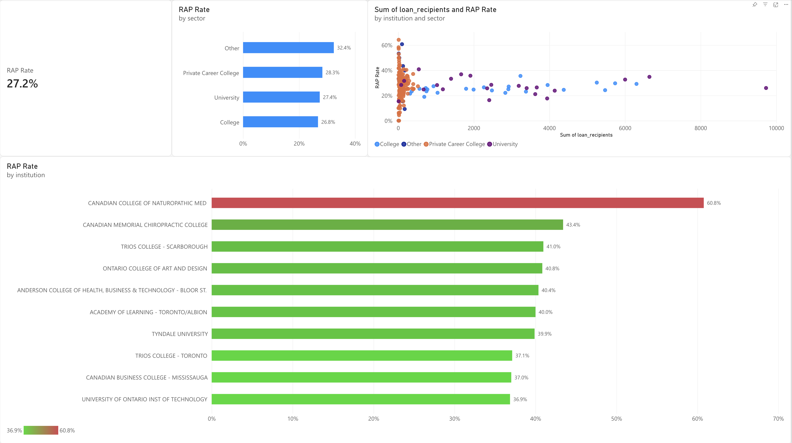
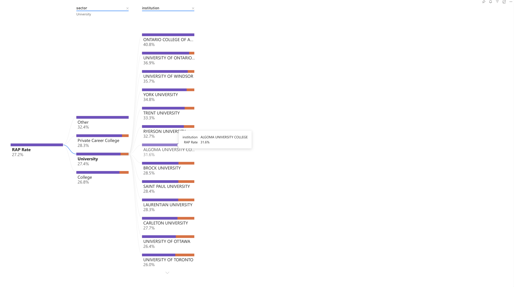

# OSAP Repayment Assistance Plan (RAP) Analysis

How many Ontario student loan borrowers needed help repaying their loans, and where was that need highest?

This project cleans, analyzes and visualizes Ontario's open data on Repayment Assistance Plan (RAP) usage across universities, colleges, private career colleges and other institutions.

**Tools:** Python (pandas), SQL (SQLite), Power BI

## Key findings

- **27.2%** of Ontario borrowers who received OSAP loans in 2017-18 used RAP before July 2020.
- **By sector:** Other 32.4%, Private Career College 28.3%, University 27.4%, College 26.8%.
- **Highest institution:** Canadian College of Naturopathic Medicine at 60.8% (institutions with 100 or more loan recipients).
- **Thunder Bay:** Lakehead University (24.9%) and Confederation College (19.0%) were both below the Ontario average. Confederation ranked 24th of 24 colleges.
- **Programs:** Fine Arts was highest at 36.7%. Engineering (18.3%), Computer Science (18.9%) and Medicine (2.8%) were among the lowest.

## Dashboard

**Overview:** Ontario RAP rate, rate by sector, and top 10 institutions

**Drill Down:** decomposition tree from sector to institution

**Thunder Bay vs Ontario:** local institutions compared with the provincial average

## Process

1. **Clean (Python):** combined 9 Excel sheets into two tidy tables, 235 institution rows and 3,828 program rows. Removed notes and total rows, standardized names, and flagged privacy-suppressed values (29 institutions, 1,543 programs).
2. **Analyze (SQL):** loaded the tables into SQLite and calculated rates by sector, institution and program using `GROUP BY`, `HAVING`, `UNION ALL` and `RANK() OVER`.
3. **Visualize (Power BI):** built a three-page dashboard with a DAX measure for the RAP rate. Every figure was checked against the SQL results.

## Files

| File | What it is |
| --- | --- |
| `osap_rap_analysis.ipynb` | Cleaning and SQL analysis notebook (Google Colab) |
| `osap_rap_2020_institutions_clean.csv` | Clean institution-level data |
| `osap_rap_2020_programs_clean.csv` | Clean program-level data |

## Limitations

- The data shows where RAP is used, not why. A high rate may reflect lower earnings, higher debt or stronger awareness of the program.
- Small institutions and programs have suppressed counts for privacy.
- One year of data only, and the period includes the early months of the pandemic.

## Data source

[OSAP Repayment Assistance Plan usage](https://data.ontario.ca/dataset/osap-repayment-assistance-plan-usage), Ontario Data Catalogue, 2020 file. Open Government Licence, Ontario.

## Author

Aashish Tank, Honours B.Sc. Computer Science, Lakehead University
